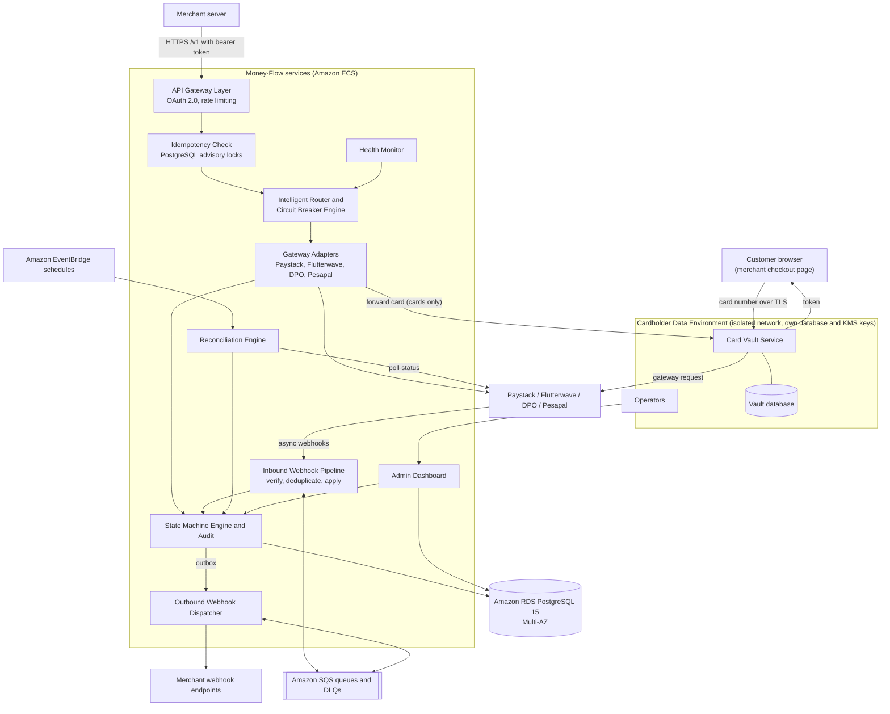

# Architecture & System Design Specification: Money-Flow Payment Orchestrator

## 1. System Overview & Objectives
**Money-Flow Payment Orchestrator** is a fault-tolerant, high-throughput payment routing and execution layer designed to eliminate silent transaction failures, prevent duplicate charges (idempotency enforcement), automate reconciliation, and provide real-time failovers across multi-gateway integrations (Paystack, Flutterwave, DPO, and Pesapal). Each merchant connects **their own** gateway accounts; money settles directly to the merchant, and Money-Flow never holds customer funds.

### 1.1 Key Architectural Metrics
* **Target Throughput:** 100+ req/sec sustained; peak volume of 180,000 transactions per day (about 2 per second on average, so the sustained target leaves large headroom).
* **Failover Latency:** $< 2.0$ seconds (P95).
* **Payment Initiation Latency:** $< 500\text{ ms}$ (P95).
* **Idempotency Execution Check:** $< 10\text{ ms}$.
* **Recovery (data centre failure):** near-zero data loss, service restored within minutes. A full AWS region outage may take longer (restore from cross-region backups).

### 1.2 Project Context
Money-Flow is a **learning project** built to production-grade design practice.


### 1.3 Companion Documents
* `transaction_state_machine_specification.md`: state diagram, full transition rules, webhook and reconciliation behaviour. **Source of truth for states and transitions.**
* `docs/schema.md`: complete database schema (all tables, enumerations, indexes, retention). **Source of truth for tables.**

---

## 2. High-Level Architecture



The Health Monitor writes gateway health readings that the router and circuit breaker read. The webhook pipeline, reconciliation engine, admin dashboard and adapters all change transaction state **only** through the State Machine Engine.

### 2.1 Payment Flow (Card)
1. **Authenticate:** the merchant server obtains a short-lived access token with OAuth 2.0 client credentials.
2. **Tokenise:** the customer enters the card on the merchant's checkout page, and the card number goes over TLS straight to the Card Vault, which returns a `card_token` plus brand and last four digits. The merchant's own servers and Money-Flow's payment API never see the card number.
3. **Create payment:** the merchant server calls `POST /v1/payments` with an `Idempotency-Key` and the token. The idempotency layer takes its lock and creates the transaction in `CREATED`.
4. **Route:** the router picks the best gateway among the merchant's connected gateway accounts (`ROUTE_SELECTED`), then the attempt starts (`AUTH_INITIATED`). The DB connection is released before any network call.
5. **Authorise:** the adapter asks the vault to forward the card to the chosen gateway. The result arrives synchronously or by gateway webhook. On failure or timeout the router may fail over to another connected gateway, reusing the same vault token.
6. **Auto-capture:** on `AUTHORISED` the vault purges the card number and security code, and the system immediately triggers capture (`CAPTURE_INITIATED`, then `CAPTURED`).
7. **Notify:** every transition writes an outbox row, and the dispatcher sends a signed webhook to the merchant.
8. **Reconcile:** the 15-minute reconciliation job fixes anything left pending, expires holds, and confirms settlement.

Non-card methods follow the same flow without steps 2 and 5's vault forwarding: the adapter calls the gateway directly with the payer reference.

---

## 3. Core Components Specification

### 3.1 Idempotency Layer
To guarantee zero double-charging:
1. **Header Requirement:** Accepts a unique `Idempotency-Key` (UUIDv4) scoped to the `merchant_id`. Required on `POST /v1/payments` and `POST /v1/payments/{id}/refunds`.
2. **Locking Strategy:** Uses transaction-level PostgreSQL advisory locks (`pg_advisory_xact_lock`) based on the hash of `(merchant_id + key)` to handle sub-millisecond race conditions across multi-node environments. Transaction-level locks remain correct behind a transaction-pooling connection proxy.
3. **Execution Logic:**
   * Reads key status from `idempotency_keys`.
   * Returns HTTP `409 Conflict` if state is `PROCESSING`.
   * Serves cached payload directly if status is `COMPLETED`.
   * Returns HTTP `422` when a key is reused with a different `request_hash`.
   * Expires keys after 24 hours via automated TTL background pruning (hard delete, hourly).
4. **Stored payloads** contain tokens and masked values only, never card numbers.

### 3.2 Intelligent Routing Algorithm & Circuit Breaker
* **Candidate gateways:** the merchant's `ACTIVE` gateway accounts, further filtered to gateways that are active, have a closed or half-open circuit, and support the payment method and currency (`gateway_payment_methods`).
* **Scoring Formula:**
  $$\text{Score}(g) = (W_{\text{success}} \cdot S_g) + (W_{\text{latency}} \cdot (1 - L_g)) + (W_{\text{cost}} \cdot (1 - C_g)) + (W_{\text{health}} \cdot H_g) + (W_{\text{fit}} \cdot F_g)$$
  * Default Weights: Success ($35\%$), Latency ($20\%$), Cost ($20\%$), Health ($15\%$), Payment Method Fit ($10\%$). Weights and thresholds are stored in `routing_config`, with optional per-merchant overrides.
  * Inputs are normalised to 0–1: success and latency from `gateway_health_metrics`; cost and fit from `gateway_payment_methods`.
* **Circuit Breaker:**
  * **CLOSED:** Standard routing using dynamic scores.
  * **OPEN:** Tripped after 5 consecutive gateway/network failures. Automatically routes traffic away to the next-highest scoring healthy gateway.
  * **HALF-OPEN:** Allows a single test request after the 30-second cooldown period.
  * Only timeouts, network errors and 5xx responses count as failures. A declined payment is a business outcome and does not trip the breaker.
* A merchant with only one connected gateway has no failover. The dashboard should surface this.

### 3.3 State Machine Engine
Manages deterministic lifecycle transitions for every transaction. Direct state mutations in the DB are strictly prohibited; every transition validates `from_state` $\rightarrow$ `to_state`, writes one `transaction_audit` row, and updates `state_updated_at` in the same database transaction.

The 15 states are: `CREATED`, `ROUTE_SELECTED`, `AUTH_INITIATED`, `AUTHORISED`, `AUTH_FAILED`, `CAPTURE_INITIATED`, `CAPTURED`, `CAPTURE_FAILED`, `REFUND_INITIATED`, `REFUNDED`, `FAILED`, `AUTH_EXPIRED`, `ABANDONED`, `SETTLED`, `RECONCILIATION_MISMATCH`.

Key rules (full diagram, transition table and rules are in the state machine specification):
1. **Lock, then validate:** read the state under `SELECT ... FOR UPDATE`, check the transition table, then write.
2. **Gateway pinning:** the gateway and gateway account can change only before `AUTHORISED`; capture and refund go to the gateway that authorised the funds.
3. **Auto-capture:** `TRIGGER_CAPTURE` is raised by the system right after `AUTHORISED`. There is no merchant capture call.
4. **Safe failover:** before failing over after a timeout, query the original gateway so a customer is never held twice.
5. **Mismatch handling:** `RECONCILIATION_MISMATCH` alerts operators and never auto-refunds; only an operator resolves it.
6. **Card data tie-in:** reaching `AUTHORISED`, `FAILED` or `ABANDONED` triggers deletion of the card number and security code from the vault.

### 3.4 Inbound Webhook Ingestion Pipeline & Dead Letter Queue (DLQ)
1. **Routing to the right secret:** each merchant gateway account gets its own webhook URL, `POST /v1/webhooks/{gateway_code}/{account_token}`. The token identifies the merchant account, so the correct signing secret is fetched from AWS Secrets Manager before verification.
2. **Verification:** Validates the HMAC signature with a constant-time comparison (Go: `hmac.Equal`) for Paystack, Flutterwave, DPO, and Pesapal.
3. **Deduplication:** Checks composite primary key `(gateway_account_id, event_id)` in `webhook_events`. Returns HTTP `200 OK` instantly for duplicates without reprocessing. The dedup row and the state transition commit in the same database transaction.
4. **Ordering:** Stale events are ignored gracefully with `200 OK`. Early events are queued and retried. Events from a previously attempted gateway are never applied blindly.
5. **Durable record plus transport:** an accepted event is first written to `webhook_queue` (the source of truth for status), then sent to SQS. SQS handles delivery and retries; a relay re-enqueues rows stuck in `PENDING`.
6. **DLQ Policy:** Retries processing failures 3 times with exponential backoff ($1\text{s}, 2\text{s}, 4\text{s}$). On the 4th failure, the event is marked `DLQ` in `webhook_queue` and moved to the SQS dead-letter queue for manual replay from the admin dashboard. Replays pass through deduplication again.

### 3.5 Automated Reconciliation Engine
* **Schedule:** an EventBridge schedule starts the batch every 15 minutes; each run is recorded in `reconciliation_runs`.
* **Mechanism:** Queries transactions stuck in pending states (`AUTH_INITIATED`, `CAPTURE_INITIATED`, `REFUND_INITIATED`) past gateway timeout limits (5 minutes). Fetches the real status by direct API polling, using the merchant's gateway account credentials from Secrets Manager, and applies the matching transition with initiator *Reconciliation Job*.
* **Hold expiry and settlement:** `AUTHORISED` or `CAPTURE_FAILED` transactions past `auth_expires_at` move to `AUTH_EXPIRED`. Confirmed settlements move `CAPTURED` to `SETTLED`.
* **Anomaly Escalation:** If internally `CAPTURED` (or `SETTLED`) but the gateway reports `FAILED` or `REVERSED`, the transaction moves to `RECONCILIATION_MISMATCH`, a `reconciliation_logs` row is written with the discrepancy flag, and operators are alerted by email. No auto-refund is ever triggered.

### 3.6 Gateway Health Monitor
Continuously pings each gateway and records response time, P95 latency, success rate and consecutive failures in `gateway_health_metrics`. The router and circuit breaker read the latest reading per gateway. Health is tracked per gateway, not per merchant account.

### 3.7 Card Vault Service
A separate service in an isolated network segment (the Cardholder Data Environment, CDE), with its **own database, KMS keys and AWS account or VPC**. It is the only component that ever holds or decrypts a card number.

* **Tokenise:** `POST /v1/cards` on a dedicated hostname accepts the card over TLS and returns a `card_token`. The payments API only ever receives tokens.
* **Forward:** the adapter asks the vault to send the gateway request. The vault inserts the card details itself, so adapters never see a card number.
* **Encryption:** envelope encryption with AWS KMS. The card number and expiry are encrypted with a per-record data key, which is itself wrapped by a KMS key. Keys are rotated.
* **Security code (CVV):** never stored after authorisation. It is held encrypted only while authorisation attempts are in progress, with a hard expiry of 15 minutes (configurable), and deleted when the transaction reaches `AUTHORISED`, `FAILED` or `ABANDONED`.
* **Retention:** the card number is purged on the same events, or after a 60-minute maximum (configurable). Saved cards are out of scope.
* **Duplicate detection:** a keyed hash (HMAC) fingerprint, never a plain hash.
* **Safe to store in clear:** token id, first six digits, last four digits, card brand.
* **Access:** only the vault role can decrypt. Every tokenise, forward and purge action is written to an append-only `vault_access_log`. Logs are retained for at least 12 months (PCI-DSS 10.5.1), with three months immediately available.
* **Failure:** if the vault is down, card payments fail fast with a clear error and no gateway is blamed; non-card methods keep working.

### 3.8 Outbound Merchant Webhooks
Merchants register endpoints (`merchant_webhook_endpoints`) and are told about outcomes by signed webhooks.

* **Outbox:** the state machine inserts a `merchant_webhook_deliveries` row (status `PENDING`) in the **same database transaction** as the state change. A relay sends it to SQS; the dispatcher POSTs to the merchant. A crash can never lose a notification.
* **Signature:** header `Money-Flow-Signature: t=<unix time>,v1=<HMAC-SHA256 of "t.payload">`, using a per-endpoint secret held in Secrets Manager. Merchants should reject timestamps older than five minutes.
* **Retries:** exponential backoff, suggested 8 attempts (30 s, 2 min, 10 min, 30 min, 1 h, 3 h, 6 h, 12 h), then `DLQ`. Operators can replay from the dashboard. Each event has a stable `event_id` so merchants can deduplicate.
* **Events:**

| Transition | Event type |
| :--- | :--- |
| to `AUTHORISED` | `payment.authorised` |
| to `CAPTURED` | `payment.captured` |
| to `SETTLED` | `payment.settled` |
| to `FAILED` | `payment.failed` |
| to `AUTH_EXPIRED` | `payment.expired` |
| to `ABANDONED` | `payment.abandoned` |
| refund succeeded (partial) | `refund.succeeded` |
| to `REFUNDED` | `payment.refunded` |
| refund failed | `refund.failed` |

`RECONCILIATION_MISMATCH` is internal and sends no merchant event. Payloads never contain card data.

### 3.9 Background Processing
* **Queues:** SQS standard queues with dead-letter queues for inbound webhook processing and outbound merchant delivery. Handlers must be idempotent because SQS delivers at least once.
* **Schedules:** EventBridge triggers reconciliation (every 15 min), idempotency TTL pruning (hourly), the retention job (nightly) and vault purges.
* **Source of truth:** the PostgreSQL tables (`webhook_queue`, `merchant_webhook_deliveries`) record status; SQS is only the transport.

### 3.10 Admin Dashboard
An internal web application for operators (see Section 8.3).

---

## 4. Data Architecture & Database Schema Design

### Key Design Rules for Financial Data:
* **Zero Floating-Point Arithmetic:** Financial amounts use `BIGINT` representing integer cents (e.g., 100.50 $\rightarrow$ 10050).
* **Immutable Audit Trail:** `transaction_audit` and `admin_audit_log` are append-only. No `UPDATE`, `DELETE` or `TRUNCATE` by application roles, and no cascading deletes from `transactions`.
* **Real tenants:** `merchant_id` is a foreign key to a `merchants` table.
* **No secrets in the database:** gateway keys, webhook secrets and signing secrets live in AWS Secrets Manager; tables hold references only.
* **Two databases:** the main Money-Flow database and the isolated Card Vault database. Tables in the main database refer to vault records by token id only.

### Relational Schema (PostgreSQL 15+)

`docs/schema.md` holds the complete definitions for all tables. The excerpts below are the design-critical ones. Every table also carries `is_deleted` and `deleted_at` for the retention policy in `docs/schema.md` (the vault database erases card data in place instead).

```sql
-- Transaction lifecycle states
CREATE TYPE transaction_state AS ENUM (
    'CREATED', 'ROUTE_SELECTED', 'AUTH_INITIATED', 'AUTHORISED', 'AUTH_FAILED',
    'CAPTURE_INITIATED', 'CAPTURED', 'CAPTURE_FAILED', 'REFUND_INITIATED', 'REFUNDED',
    'FAILED', 'AUTH_EXPIRED', 'ABANDONED', 'SETTLED', 'RECONCILIATION_MISMATCH'
);

-- Core Transactions Table
CREATE TABLE transactions (
    id UUID PRIMARY KEY DEFAULT gen_random_uuid(),
    merchant_id UUID NOT NULL REFERENCES merchants(id),
    merchant_order_id VARCHAR(100) NOT NULL,
    amount_cents BIGINT NOT NULL CHECK (amount_cents > 0),
    currency VARCHAR(3) NOT NULL DEFAULT 'KES',
    payment_method VARCHAR(50) NOT NULL,
    gateway_id UUID REFERENCES gateways(id),                         -- pinned once AUTHORISED
    gateway_account_id UUID REFERENCES merchant_gateway_accounts(id), -- pinned once AUTHORISED
    gateway_reference VARCHAR(255),
    card_token_id UUID,                                  -- logical reference to the vault, no card data
    card_brand VARCHAR(20),
    card_last4 CHAR(4),
    payer_hint VARCHAR(20),                              -- masked payer reference for non-card methods
    attempt_count INTEGER NOT NULL DEFAULT 0,            -- incremented on every entry to ROUTE_SELECTED
    state transaction_state NOT NULL DEFAULT 'CREATED',
    state_updated_at TIMESTAMPTZ NOT NULL DEFAULT NOW(),
    auth_expires_at TIMESTAMPTZ,
    created_at TIMESTAMPTZ NOT NULL DEFAULT NOW(),
    updated_at TIMESTAMPTZ NOT NULL DEFAULT NOW(),
    is_deleted BOOLEAN NOT NULL DEFAULT FALSE,
    deleted_at TIMESTAMPTZ,
    CONSTRAINT unique_merchant_order UNIQUE (merchant_id, merchant_order_id)
);

CREATE INDEX idx_transactions_merchant_state ON transactions (merchant_id, state);
CREATE INDEX idx_transactions_state ON transactions (state);
CREATE INDEX idx_transactions_created_at ON transactions (created_at);
CREATE INDEX idx_transactions_pending_recon ON transactions (state_updated_at)
    WHERE state IN ('AUTH_INITIATED', 'CAPTURE_INITIATED', 'REFUND_INITIATED');
CREATE INDEX idx_transactions_auth_expiry ON transactions (auth_expires_at)
    WHERE state = 'AUTHORISED';

-- Gateway pinning: gateway and gateway account cannot change once AUTHORISED or later
CREATE FUNCTION enforce_gateway_pinning() RETURNS trigger AS $$
BEGIN
    IF (NEW.gateway_id IS DISTINCT FROM OLD.gateway_id
        OR NEW.gateway_account_id IS DISTINCT FROM OLD.gateway_account_id)
       AND OLD.state NOT IN ('CREATED', 'ROUTE_SELECTED', 'AUTH_INITIATED', 'AUTH_FAILED') THEN
        RAISE EXCEPTION 'gateway is pinned once a transaction is AUTHORISED';
    END IF;
    RETURN NEW;
END;
$$ LANGUAGE plpgsql;

CREATE TRIGGER trg_gateway_pinning BEFORE UPDATE ON transactions
    FOR EACH ROW EXECUTE FUNCTION enforce_gateway_pinning();

-- Immutable Transaction State Audit Trail (append-only)
CREATE TABLE transaction_audit (
    id UUID PRIMARY KEY DEFAULT gen_random_uuid(),
    transaction_id UUID NOT NULL REFERENCES transactions(id) ON DELETE RESTRICT,
    from_state transaction_state,                      -- NULL only for the initial CREATED row
    to_state transaction_state NOT NULL,
    event VARCHAR(100) NOT NULL,
    attempt_number INTEGER,
    gateway_id UUID REFERENCES gateways(id),
    gateway_reference VARCHAR(255),
    gateway_response JSONB,                            -- PII redacted before insert, never card data
    metadata JSONB,
    created_at TIMESTAMPTZ NOT NULL DEFAULT NOW(),
    created_by VARCHAR(100) NOT NULL DEFAULT 'system',
    is_deleted BOOLEAN NOT NULL DEFAULT FALSE,
    deleted_at TIMESTAMPTZ
);

CREATE INDEX idx_audit_tx ON transaction_audit (transaction_id, created_at);
CREATE INDEX idx_audit_tx_gateway ON transaction_audit (transaction_id, gateway_id);

-- Enforce immutability: only the retention role may flag or remove rows that are already
-- soft-deleted; nobody may change any other column.
CREATE FUNCTION forbid_audit_mutation() RETURNS trigger AS $$
BEGIN
    IF current_user = 'retention_job' THEN
        IF TG_OP = 'DELETE' AND OLD.is_deleted THEN
            RETURN OLD;
        END IF;
        IF TG_OP = 'UPDATE'
           AND (to_jsonb(NEW) - 'is_deleted' - 'deleted_at') = (to_jsonb(OLD) - 'is_deleted' - 'deleted_at') THEN
            RETURN NEW;
        END IF;
    END IF;
    RAISE EXCEPTION 'append-only table: updates and deletes are not allowed';
END;
$$ LANGUAGE plpgsql;

CREATE TRIGGER trg_audit_immutable BEFORE UPDATE OR DELETE ON transaction_audit
    FOR EACH ROW EXECUTE FUNCTION forbid_audit_mutation();

CREATE TRIGGER trg_audit_no_truncate BEFORE TRUNCATE ON transaction_audit
    FOR EACH STATEMENT EXECUTE FUNCTION forbid_audit_mutation();

REVOKE UPDATE, DELETE, TRUNCATE ON transaction_audit FROM PUBLIC;
-- The same trigger pattern is applied to admin_audit_log.

-- Idempotency Keys Store
CREATE TABLE idempotency_keys (
    id UUID NOT NULL UNIQUE DEFAULT gen_random_uuid(),
    merchant_id UUID NOT NULL REFERENCES merchants(id),
    key VARCHAR(255) NOT NULL,
    transaction_id UUID REFERENCES transactions(id),
    request_hash VARCHAR(64) NOT NULL,
    request_payload JSONB,                             -- tokens and masked values only
    status VARCHAR(20) NOT NULL DEFAULT 'PROCESSING' CHECK (status IN ('PROCESSING', 'COMPLETED', 'FAILED')),
    response_code INTEGER,
    response_body JSONB,
    created_at TIMESTAMPTZ NOT NULL DEFAULT NOW(),
    updated_at TIMESTAMPTZ NOT NULL DEFAULT NOW(),
    expires_at TIMESTAMPTZ NOT NULL DEFAULT (NOW() + INTERVAL '24 hours'),
    is_deleted BOOLEAN NOT NULL DEFAULT FALSE,
    deleted_at TIMESTAMPTZ,
    PRIMARY KEY (merchant_id, key)
);

-- Covers ALL rows so the 24-hour TTL prune can use it (completed keys expire too)
CREATE INDEX idx_idempotency_expires ON idempotency_keys (expires_at);

-- Processed Webhook Events (Deduplication Store)
CREATE TABLE webhook_events (
    gateway_account_id UUID NOT NULL REFERENCES merchant_gateway_accounts(id),
    event_id VARCHAR(255) NOT NULL,                    -- the gateway's own event id
    gateway_id UUID NOT NULL REFERENCES gateways(id),
    event VARCHAR(100) NOT NULL,
    payload_hash VARCHAR(64) NOT NULL,
    request_payload JSONB,                             -- raw body, PII redacted
    payload JSONB,                                     -- normalised event
    transaction_id UUID REFERENCES transactions(id),
    processed_at TIMESTAMPTZ NOT NULL DEFAULT NOW(),
    created_at TIMESTAMPTZ NOT NULL DEFAULT NOW(),
    is_deleted BOOLEAN NOT NULL DEFAULT FALSE,
    deleted_at TIMESTAMPTZ,
    PRIMARY KEY (gateway_account_id, event_id)
);

-- Inbound webhook processing record (SQS does delivery; this table is the source of truth)
CREATE TABLE webhook_queue (
    id BIGSERIAL PRIMARY KEY,
    gateway_account_id UUID NOT NULL REFERENCES merchant_gateway_accounts(id),
    gateway_id UUID NOT NULL REFERENCES gateways(id),
    event_id VARCHAR(255) NOT NULL,
    payload JSONB NOT NULL,
    signature TEXT NOT NULL,
    status VARCHAR(20) NOT NULL DEFAULT 'PENDING' CHECK (status IN ('PENDING', 'PROCESSING', 'COMPLETED', 'FAILED', 'DLQ')),
    retry_count INTEGER NOT NULL DEFAULT 0,
    max_retries INTEGER NOT NULL DEFAULT 3,
    next_retry_at TIMESTAMPTZ,
    error_message TEXT,
    created_at TIMESTAMPTZ NOT NULL DEFAULT NOW(),
    updated_at TIMESTAMPTZ NOT NULL DEFAULT NOW(),
    processed_at TIMESTAMPTZ,
    is_deleted BOOLEAN NOT NULL DEFAULT FALSE,
    deleted_at TIMESTAMPTZ,
    CONSTRAINT unique_queue_event UNIQUE (gateway_account_id, event_id)
);

CREATE INDEX idx_webhook_queue_retry ON webhook_queue (next_retry_at) WHERE status IN ('PENDING', 'FAILED');
CREATE INDEX idx_webhook_queue_dlq ON webhook_queue (created_at) WHERE status = 'DLQ';
```

---

## 5. API Contract (v1)

* **Base path:** `/v1`. The version lives in the URL; breaking changes ship as `/v2`.
* **Format:** JSON over HTTPS (TLS 1.2 or higher). Amounts are integer cents in `amount_cents`.
* **Authentication:** `Authorization: Bearer <access_token>`. Tokens come from `POST /v1/oauth/token` (grant type `client_credentials`, using `client_id` and `client_secret`) and last 1 hour by default (configurable). Scopes: `payments:read`, `payments:write`, `refunds:write`, `gateway_accounts:manage`, `webhooks:manage`.
* **Idempotency:** `Idempotency-Key` header, required on every `POST` that creates a payment or refund.
* **Rate limiting:** per merchant (`merchants.rate_limit_rps`); exceeded requests get `429` with `Retry-After`.

| Method and path | Purpose | Notes |
| :--- | :--- | :--- |
| `POST /v1/oauth/token` | Obtain access token | Client credentials |
| `POST /v1/cards` | Tokenise a card | **Vault hostname**, returns `card_token`, brand, last4. Not the payments API host |
| `POST /v1/payments` | Create a payment | Body: `merchant_order_id`, `amount_cents`, `currency`, `payment_method` (`card_token` or payer reference). Returns `202` with the payment and its `state` |
| `GET /v1/payments/{id}` | Fetch a payment and its state | |
| `GET /v1/payments` | List payments | Filter by state, date, `merchant_order_id`; cursor pagination |
| `POST /v1/payments/{id}/refunds` | Refund fully or partly | Optional `amount_cents`; capped by refundable balance |
| `GET /v1/payments/{id}/refunds` | List refunds | |
| `POST /v1/gateway-accounts` | Connect a gateway account | Credentials are written to Secrets Manager; the response returns the per-account webhook URL to register at the gateway |
| `GET/PATCH/DELETE /v1/gateway-accounts/{id}` | Manage connections | |
| `POST /v1/webhook-endpoints` | Register a merchant webhook URL | Returns the signing secret once |
| `GET/PATCH/DELETE /v1/webhook-endpoints/{id}` | Manage endpoints | |
| `POST /v1/webhooks/{gateway_code}/{account_token}` | **Inbound** gateway webhooks | Called by gateways, not merchants; HMAC-verified |

There is no capture endpoint because capture is automatic.

**Errors:** `{"error": {"code": "...", "message": "...", "request_id": "..."}}` with these statuses: `400` validation, `401` bad or expired token, `403` missing scope, `404` not found, `409` idempotency key still `PROCESSING`, `422` key reused with different request or invalid state for the operation, `429` rate limit, `502/503` upstream or vault unavailable.

---

## 6. Deployment & Infrastructure

* **Provider and region:** AWS, in an African region (for example Africa (Cape Town), `af-south-1`). Confirm every service used is available in the chosen region.
* **Compute:** containers on Amazon ECS, with separate services for: `api`, `workers` (SQS consumers, outbox relay, outbound dispatcher), `health-monitor`, `admin`, and the isolated `vault`. Scheduled jobs run as ECS tasks started by EventBridge. Images are stored in ECR.
* **Database:** Amazon RDS for PostgreSQL 15, Multi-AZ, encrypted with KMS, with automated backups and point-in-time recovery. A connection proxy (for example RDS Proxy) is recommended to protect against connection pool exhaustion.
* **Network:** one VPC across multiple availability zones. A public load balancer with a web application firewall fronts `api`; ECS tasks, RDS and the vault run in private subnets. Outbound traffic to gateways leaves through NAT gateways with fixed Elastic IPs, so gateways that require IP allow-listing can be satisfied. The vault sits in its own subnets, security groups and, preferably, its own AWS account.
* **Secrets and keys:** AWS Secrets Manager for merchant gateway credentials, webhook secrets and webhook signing secrets; AWS KMS for database encryption and vault envelope keys.
* **Messaging:** Amazon SQS (with dead-letter queues) and Amazon EventBridge.
* **Environments:** four fully separate deployments, each with its own database and secrets, ideally in separate AWS accounts.

| Environment | Purpose | Gateways |
| :--- | :--- | :--- |
| Development | Engineers' work | Gateway test mode |
| Staging | Pre-release testing, load and failover tests | Gateway test mode |
| Production | Live traffic | Live accounts |
| Merchant sandbox | Merchants integrate and test | Gateway test mode, test card numbers only |

* **Recovery targets:** for a data centre (availability zone) failure, RDS Multi-AZ fails over automatically in about a minute or two with no committed data loss, and ECS reschedules tasks across zones. For a **full region outage**, recovery uses cross-region backup copies and takes longer; this is accepted for v1.
* **Capacity:** 180,000 transactions per day is roughly 2 per second on average. With about six audit rows per transaction, `transaction_audit` grows by around 1 million rows a day, so it and `gateway_health_metrics` should be partitioned by month. The API scales horizontally on request count and CPU.
* **Open choices:** infrastructure-as-code tool and CI/CD pipeline are not yet chosen (Section 10).

---

## 7. Security Architecture

### 7.1 Merchant Authentication and Authorisation
OAuth 2.0 client credentials with scoped, short-lived access tokens. Client secrets are shown once and stored only as a hash (`merchant_oauth_clients`). Revocation takes effect within the token lifetime.

### 7.2 Secrets Management
Per-merchant gateway keys, gateway webhook secrets and merchant webhook signing secrets are held in AWS Secrets Manager. The database stores only references. Access is limited by IAM role per service.

### 7.3 Encryption
TLS 1.2 or higher for all traffic; RDS, SQS and backups encrypted at rest with KMS; vault records protected by envelope encryption.

### 7.4 Data Protection
* No card numbers, security codes or secrets in logs, traces, error messages, queues, audit rows, idempotency payloads or webhook payloads. Redaction happens before insert, and log scrubbing is automated (for example CloudWatch Logs data protection policies, to be verified).
* Cards are shown only masked (at most first six and last four digits).
* Operators and engineers see tokens and masked values only.
* Kenya's Data Protection Act applies to personal data; confirm data location and breach-reporting duties with legal advice.

### 7.5 PCI-DSS
Handling raw card numbers places Money-Flow in full PCI-DSS scope as a service provider (a self-assessment is not enough at scale; an assessor-led audit is expected). The design reduces the scope by isolating all card handling in the vault (Section 3.7), but it does not remove it. **Because this is a learning project, use only gateway test card numbers.** Before any real card is processed, engage a qualified security assessor (QSA) and confirm each gateway allows direct card charges for your account.

### 7.6 Operator Access
Operators sign in to the dashboard through an identity provider with multi-factor authentication and role-based access (viewer, operator, admin). Every operator action is recorded in `admin_audit_log` (append-only).

### 7.7 Webhook Security
Inbound webhooks use per-account URLs plus HMAC verification with constant-time comparison. Outbound webhooks are signed with a timestamp to prevent replay.

---

## 8. Observability & Operations

### 8.1 Logging, Metrics, Tracing
* **Logs:** structured JSON in Amazon CloudWatch Logs with a correlation id (`request_id`, `transaction_id`) on every line.
* **Metrics (CloudWatch):** request rate and latency (P50/P95/P99) per endpoint, failover count and failover latency, per-gateway success rate and latency, circuit breaker state, transactions by state, count of transactions stuck in pending states, queue depth and oldest message age, DLQ size, outbound delivery success rate, vault errors and latency, RDS CPU, connections and failover events.
* **Tracing:** AWS X-Ray across API, router, adapters and workers.

### 8.2 Alerting
Alarms notify operators **by email** (for example CloudWatch alarms through SNS or SES). Alerts: reconciliation mismatch, DLQ items, circuit breaker opened, failover rate or failover P95 above target, stuck transactions, vault unavailable, outbound delivery failure rate, RDS failover, API error rate or latency above target, and a gateway account marked invalid. Email alone is slow for a payments incident; a paging channel should be considered before real traffic.

### 8.3 Operator Tooling (Admin Dashboard)
* Search transactions and view the full audit trail and gateway attempts.
* Replay inbound DLQ items and failed outbound deliveries.
* Resolve `RECONCILIATION_MISMATCH` with `MANUAL_RESOLVE_CAPTURED`, `MANUAL_RESOLVE_FAILED` or `MANUAL_REFUND`, requiring a reason.
* View circuit breaker status and use a gateway kill-switch (`gateways.is_active`).
* Manage merchants, OAuth clients, gateway accounts and webhook endpoints.
* Never display card data. Every action goes to `admin_audit_log`.

---

## 9. Failure Recovery & Concurrency Handling Matrix

| Edge Case / Failure Scenario | Prevention / Resolution Design |
| :--- | :--- |
| **Simultaneous Requests (Race Condition)** | PostgreSQL advisory lock on hash of `(merchant_id + idempotency_key)` before state check. Second request gets 409 Conflict. |
| **Simultaneous events on one transaction** | `SELECT ... FOR UPDATE` on the transaction row. The second event is evaluated against the new state, then applied, ignored as stale, or rejected. |
| **Gateway Timeout during Auth/Capture** | Circuit breaker updates failure metric; failover to another connected gateway within the 2 second P95 target. Before failing over an auth, the original gateway is queried so the customer is never held twice. |
| **Card failover** | The same vault token is retried at the next gateway. If the vault entry has expired, the transaction ends `FAILED` with reason `CARD_DATA_UNAVAILABLE` and the customer must pay again. |
| **Merchant has one gateway only** | No failover possible; the transaction fails after the attempt limit. Dashboard flags the merchant. |
| **Webhook Out-of-Order Delivery** | Stale events are ignored gracefully; early events are queued and retried with backoff. |
| **Duplicate Webhook Delivery** | Composite key `(gateway_account_id, event_id)` in `webhook_events`; duplicate returns `200 OK` without reprocessing. |
| **Late webhook from a previously attempted gateway** | Checked against the transaction's current gateway and state before applying. A conflicting authorisation is flagged for reconciliation. |
| **Webhook delivered but SQS send fails** | The row is already in `webhook_queue`/`merchant_webhook_deliveries` as `PENDING`; the relay re-enqueues it. |
| **Merchant endpoint down** | Outbound retries with backoff, then `DLQ`; operators can replay; merchants can also poll `GET /v1/payments/{id}`. |
| **Transaction stuck in a pending state** | Reconciliation polls the gateway every 15 minutes for transactions pending more than 5 minutes. |
| **Internal `CAPTURED` but gateway says `FAILED`/`REVERSED`** | Moves to `RECONCILIATION_MISMATCH`, logged and alerted. No auto-refund; an operator resolves it. |
| **Authorisation never captured (capture keeps failing)** | Reconciliation moves it to `AUTH_EXPIRED` once `auth_expires_at` passes. |
| **Gateway down / degraded** | Health Monitor feeds the circuit breaker; an `OPEN` gateway is excluded until the cooldown and a successful half-open probe. |
| **Card Vault unavailable** | Card payments fail fast with a clear error; no card data is queued anywhere; non-card methods continue. |
| **Invalid merchant gateway credentials** | Gateway account is marked `DISABLED`, an alert is sent, and routing skips it. |
| **Tampering with audit history** | Triggers and revoked privileges block `UPDATE`, `DELETE` and `TRUNCATE` on `transaction_audit` and `admin_audit_log`; foreign key is `ON DELETE RESTRICT`. |
| **Availability zone failure** | RDS Multi-AZ failover and ECS rescheduling; target is no data loss and recovery in minutes. |
| **Connection Pool Exhaustion** | Short-lived DB connections acquired only to read/write state and released **before** any HTTP gateway call (including status checks and reconciliation polling), plus a connection proxy. |

---

