# Database Schema Specification (`docs/schema.md`)

## 1. Architectural Overview

This database schema is designed for a multi-tenant, high-throughput payment orchestration platform (100+ req/sec sustained, peak 180,000 transactions daily) running on Amazon RDS for PostgreSQL 15+ (Multi-AZ). To ensure strict data safety and auditability, the architecture adheres to several core financial engineering principles:

* **Two databases:** the **main database** (18 tables) and an isolated **card vault database** (3 tables) inside the Cardholder Data Environment. The main database never holds card numbers; it refers to vault records by token id only.
* **Immutability of Financial Records:** `transaction_audit` and `admin_audit_log` are strictly append-only (no `UPDATE`, no per-row delete; enforced by trigger and DB role grants). Transaction state changes only occur through the state machine, which validates `from_state → to_state` and writes one audit row per transition in the same database transaction.
* **Multi-Tenant Isolation:** Idempotency keys are scoped per merchant using the composite key `(merchant_id, key)`. Each merchant brings their own gateway accounts (`merchant_gateway_accounts`).
* **Concurrency Safety:** Idempotency uses `pg_advisory_xact_lock` on the hash of `(merchant_id + key)`. State transitions use `SELECT ... FOR UPDATE` on the `transactions` row. Unique constraints are the last line of defence against double charges.
* **Precision Handling:** All monetary amounts are `BIGINT` integer cents (e.g. KES 100.50 → `10050`). No floating-point arithmetic anywhere in financial data.
* **Secrets stay out of the database:** gateway credentials, webhook secrets and signing secrets live in AWS Secrets Manager. Tables store references (`*_secret_ref`) only.
* **Transactional outbox:** events that must reach merchants or queues (`merchant_webhook_deliveries`, `webhook_queue`) are written as rows in the same database transaction as the change that caused them. SQS is only the transport.
* **Short-Lived Connections:** Connections are acquired only to read/write state and are released **before** any HTTP call to a gateway or the vault.
* **Retention:** Every main-database table carries `is_deleted` and `deleted_at`. Operational data and financial records follow different retention rules (Section 7). Vault tables erase card data in place instead (Section 4.2).
* **Identifiers:** Core entities use `UUID` primary keys (`gen_random_uuid()`). High-volume append-only technical tables (`gateway_health_metrics`, `webhook_queue`) use `BIGINT` identity keys.
* **Sandbox:** the merchant sandbox is a separate deployment with its own databases, so no environment flag is stored on rows.


---

## 2. Entity-Relationship (ER) Diagram

The diagram shows keys and the most important columns. Full column lists are in Section 4.

```mermaid
erDiagram
    merchants ||--o{ transactions : "places"
    merchants ||--o{ idempotency_keys : "owns"
    merchants ||--o{ merchant_oauth_clients : "authenticates with"
    merchants ||--o{ merchant_gateway_accounts : "connects"
    merchants ||--o{ merchant_webhook_endpoints : "registers"
    merchants |o--o{ routing_config : "overrides"
    gateways ||--o{ merchant_gateway_accounts : "offered as"
    gateways ||--o{ gateway_health_metrics : "monitors"
    gateways ||--o{ gateway_payment_methods : "supports"
    gateways ||--o{ transactions : "processes"
    gateways ||--o{ transaction_audit : "attempted_on"
    gateways ||--o{ refunds : "refunds_via"
    gateways ||--o{ reconciliation_logs : "checked_against"
    merchant_gateway_accounts ||--o{ transactions : "used by"
    merchant_gateway_accounts ||--o{ webhook_events : "receives"
    merchant_gateway_accounts ||--o{ webhook_queue : "queues"
    merchant_webhook_endpoints ||--o{ merchant_webhook_deliveries : "receives"
    transactions ||--o{ merchant_webhook_deliveries : "notifies"
    transactions ||--o{ transaction_audit : "logs"
    transactions ||--o{ idempotency_keys : "maps"
    transactions ||--o{ reconciliation_logs : "reconciles"
    transactions ||--o{ refunds : "refunds"
    transactions ||--o{ webhook_events : "triggers"
    reconciliation_runs ||--o{ reconciliation_logs : "produces"
    vault_cards ||--o| vault_security_codes : "has"
    vault_cards ||--o{ vault_access_log : "accessed"
    transactions }o..o| vault_cards : "card_token_id (logical, cross-database)"

    merchants {
        uuid id PK
        string email UK
        string password_hash
        string status
        int rate_limit_rps
    }
    merchant_oauth_clients {
        uuid id PK
        uuid merchant_id FK
        string client_id UK
        string client_secret_hash
        string scopes
        string status
    }
    merchant_gateway_accounts {
        uuid id PK
        uuid merchant_id FK
        uuid gateway_id FK
        string credentials_secret_ref
        string webhook_secret_ref
        string webhook_path_token UK
        string status
    }
    merchant_webhook_endpoints {
        uuid id PK
        uuid merchant_id FK
        string url
        string signing_secret_ref
        string status
    }
    merchant_webhook_deliveries {
        uuid id PK
        uuid endpoint_id FK
        uuid transaction_id FK
        uuid event_id UK
        string event_type
        string status
        int attempt_count
    }
    gateways {
        uuid id PK
        string name
        string code UK
        boolean is_active
    }
    gateway_payment_methods {
        uuid id PK
        uuid gateway_id FK
        string payment_method
        string currency
        numeric fit_score
    }
    routing_config {
        uuid id PK
        uuid merchant_id FK
        smallint weight_success
        int max_auth_attempts
    }
    transactions {
        uuid id PK
        uuid merchant_id FK
        string merchant_order_id
        bigint amount_cents
        uuid gateway_id FK
        uuid gateway_account_id FK
        uuid card_token_id
        string state
        timestamptz state_updated_at
    }
    transaction_audit {
        uuid id PK
        uuid transaction_id FK
        string from_state
        string to_state
        string event
        uuid gateway_id FK
        string created_by
    }
    idempotency_keys {
        uuid id UK
        string key PK
        uuid merchant_id PK, FK
        uuid transaction_id FK
        string request_hash
        string status
    }
    gateway_health_metrics {
        bigint id PK
        uuid gateway_id FK
        string circuit_state
        int consecutive_failures
        timestamptz checked_at
    }
    reconciliation_runs {
        uuid id PK
        string status
        int mismatch_count
    }
    reconciliation_logs {
        uuid id PK
        uuid run_id FK
        uuid transaction_id FK
        uuid gateway_id FK
        string discrepancy_type
        boolean discrepancy_flag
    }
    refunds {
        uuid id PK
        uuid transaction_id FK
        uuid gateway_id FK
        bigint amount_cents
        string status
    }
    webhook_events {
        string event_id PK
        uuid gateway_account_id PK, FK
        uuid gateway_id FK
        uuid transaction_id FK
    }
    webhook_queue {
        bigint id PK
        uuid gateway_account_id FK
        string event_id
        string status
        int retry_count
    }
    admin_audit_log {
        uuid id PK
        string operator_id
        string action
        string target_type
        string target_id
    }
    vault_cards {
        uuid id PK
        bytea encrypted_pan
        string pan_fingerprint
        string last4
        string status
        timestamptz expires_at
    }
    vault_security_codes {
        uuid card_id PK, FK
        bytea encrypted_cvv
        timestamptz expires_at
    }
    vault_access_log {
        uuid id PK
        uuid card_id FK
        string action
        string actor
    }
```



---

## 3. Enumerations & Check Constraints

| Name | Allowed values |
|---|---|
| `transaction_state` (PG enum, used by `transactions.state`, `transaction_audit.from_state/to_state`, `reconciliation_logs.internal_state`) | `CREATED`, `ROUTE_SELECTED`, `AUTH_INITIATED`, `AUTHORISED`, `AUTH_FAILED`, `CAPTURE_INITIATED`, `CAPTURED`, `CAPTURE_FAILED`, `REFUND_INITIATED`, `REFUNDED`, `FAILED`, `AUTH_EXPIRED`, `ABANDONED`, `SETTLED`, `RECONCILIATION_MISMATCH` |
| `idempotency_keys.status` | `PROCESSING`, `COMPLETED`, `FAILED` |
| `gateway_health_metrics.circuit_state` | `CLOSED`, `OPEN`, `HALF_OPEN` |
| `gateway_health_metrics.ping_status` | `UP`, `DEGRADED`, `DOWN` |
| `webhook_queue.status` | `PENDING`, `PROCESSING`, `COMPLETED`, `FAILED`, `DLQ` |
| `merchant_webhook_deliveries.status` | `PENDING`, `DELIVERED`, `FAILED`, `DLQ` |
| `refunds.status` | `INITIATED`, `SUCCEEDED`, `FAILED` |
| `reconciliation_runs.status` | `RUNNING`, `COMPLETED`, `FAILED` |
| `reconciliation_logs.discrepancy_type` | `STUCK_PENDING_RESOLVED`, `CAPTURED_GATEWAY_FAILED`, `CAPTURED_GATEWAY_REVERSED`, `AMOUNT_MISMATCH`, `NOT_FOUND_AT_GATEWAY` |
| `reconciliation_logs.resolution_status` | `AUTO_RESOLVED`, `OPEN`, `RESOLVED_MANUALLY` |
| `merchants.status` | `ACTIVE`, `SUSPENDED` |
| `merchant_oauth_clients.status` | `ACTIVE`, `REVOKED` |
| `merchant_gateway_accounts.status` | `PENDING_VERIFICATION`, `ACTIVE`, `DISABLED` |
| `merchant_webhook_endpoints.status` | `ACTIVE`, `DISABLED` |
| `vault_cards.status` | `ACTIVE`, `PURGED` |
| `vault_access_log.action` | `TOKENIZE`, `FORWARD`, `PURGE`, `EXPIRE` |

Other constraints: `amount_cents > 0` on `transactions` and `refunds`; `routing_config` weights must sum to `100`; `fit_score` between `0` and `1`; `retry_count <= max_retries + 1` on `webhook_queue`.

---

## 4. Table Definitions

Every main-database table also has `is_deleted BOOLEAN NOT NULL DEFAULT FALSE` and `deleted_at TIMESTAMPTZ` (soft delete), shown as one row below. `created_at`/`updated_at` are `TIMESTAMPTZ NOT NULL DEFAULT NOW()`.

### 4.1 Main Database

#### `merchants`
Stores tenant profile information.

| Column | Type | Notes |
|---|---|---|
| `id` | UUID | Primary Key, default `gen_random_uuid()` |
| `first_name`, `last_name` | VARCHAR(100) | |
| `email` | VARCHAR(255) | Unique among live rows (partial unique index) |
| `password_hash` | VARCHAR(255) | Salted hash (argon2/bcrypt). Never plaintext |
| `status` | VARCHAR(20) | `ACTIVE` (default) / `SUSPENDED` |
| `rate_limit_rps` | INTEGER | Per-merchant API rate limit; `NULL` = platform default |
| `created_at`, `updated_at` | TIMESTAMPTZ | |
| `is_deleted`, `deleted_at` | BOOLEAN / TIMESTAMPTZ | Soft delete |

#### `merchant_oauth_clients` *(replaces `merchant_api_keys`)*
OAuth 2.0 client credentials used to obtain access tokens. Access tokens are short-lived and stateless, so they are not stored.

| Column | Type | Notes |
|---|---|---|
| `id` | UUID | Primary Key |
| `merchant_id` | UUID | Foreign Key → `merchants.id`, NOT NULL |
| `client_id` | VARCHAR(64) | Unique, public identifier |
| `client_secret_hash` | VARCHAR(255) | Hash of the secret. The secret is shown once at creation |
| `label` | VARCHAR(100) | |
| `scopes` | VARCHAR(500) | Space-separated: `payments:read`, `payments:write`, `refunds:write`, `gateway_accounts:manage`, `webhooks:manage` |
| `status` | VARCHAR(20) | `ACTIVE` (default) / `REVOKED` |
| `secret_rotated_at`, `last_used_at`, `expires_at` | TIMESTAMPTZ | |
| `created_at`, `updated_at` | TIMESTAMPTZ | |
| `is_deleted`, `deleted_at` | BOOLEAN / TIMESTAMPTZ | Soft delete |

#### `gateways`
Supported external payment providers (Paystack, Flutterwave, DPO, Pesapal). Platform-level data only; merchant credentials are in `merchant_gateway_accounts`.

| Column | Type | Notes |
|---|---|---|
| `id` | UUID | Primary Key |
| `name` | VARCHAR(100) | Display name |
| `code` | VARCHAR(30) | Unique machine code: `PAYSTACK`, `FLUTTERWAVE`, `DPO`, `PESAPAL`; used by adapters and webhook URLs |
| `is_active` | BOOLEAN | Operator kill-switch; inactive gateways are excluded from routing for everyone |
| `created_at`, `updated_at` | TIMESTAMPTZ | |
| `is_deleted`, `deleted_at` | BOOLEAN / TIMESTAMPTZ | Soft delete |

*(The `webhook_secret_ref` column moved to `merchant_gateway_accounts`, because each merchant has their own gateway webhook secret.)*

#### `merchant_gateway_accounts` *(new)*
A merchant's own account at a gateway. Routing for a merchant can only choose among its `ACTIVE` accounts.

| Column | Type | Notes |
|---|---|---|
| `id` | UUID | Primary Key |
| `merchant_id` | UUID | Foreign Key → `merchants.id`, NOT NULL |
| `gateway_id` | UUID | Foreign Key → `gateways.id`, NOT NULL |
| `credentials_secret_ref` | VARCHAR(255) | Reference (ARN or name) to the API keys in AWS Secrets Manager. **Never the keys themselves** |
| `webhook_secret_ref` | VARCHAR(255) | Reference to the gateway webhook signing secret in Secrets Manager |
| `webhook_path_token` | VARCHAR(64) | Unique opaque token in this account's inbound webhook URL `/v1/webhooks/{gateway_code}/{token}` |
| `status` | VARCHAR(30) | `PENDING_VERIFICATION` (default), `ACTIVE`, `DISABLED` (set automatically when credentials fail) |
| `last_verified_at` | TIMESTAMPTZ | |
| `created_at`, `updated_at` | TIMESTAMPTZ | |
| `is_deleted`, `deleted_at` | BOOLEAN / TIMESTAMPTZ | Soft delete |

Unique: `(merchant_id, gateway_id)` among live rows.

#### `merchant_webhook_endpoints` *(new)*
Where Money-Flow sends webhooks to a merchant.

| Column | Type | Notes |
|---|---|---|
| `id` | UUID | Primary Key |
| `merchant_id` | UUID | Foreign Key → `merchants.id`, NOT NULL |
| `url` | VARCHAR(2048) | HTTPS only |
| `signing_secret_ref` | VARCHAR(255) | Reference to the signing secret in Secrets Manager |
| `event_types` | VARCHAR(1000) | Subscribed event types; empty = all |
| `status` | VARCHAR(20) | `ACTIVE` (default) / `DISABLED` |
| `created_at`, `updated_at` | TIMESTAMPTZ | |
| `is_deleted`, `deleted_at` | BOOLEAN / TIMESTAMPTZ | Soft delete |

#### `merchant_webhook_deliveries` *(new)*
Outbox and delivery record for outbound merchant webhooks. Inserted in the same database transaction as the state change.

| Column | Type | Notes |
|---|---|---|
| `id` | UUID | Primary Key |
| `endpoint_id` | UUID | Foreign Key → `merchant_webhook_endpoints.id` |
| `transaction_id` | UUID | Foreign Key → `transactions.id` |
| `event_id` | UUID | Stable id sent to the merchant so they can deduplicate |
| `event_type` | VARCHAR(100) | e.g. `payment.captured` |
| `payload` | JSONB | Never contains card data |
| `status` | VARCHAR(20) | `PENDING` (default), `DELIVERED`, `FAILED`, `DLQ` |
| `attempt_count`, `max_attempts` | INTEGER | `max_attempts` default `8` |
| `next_attempt_at` | TIMESTAMPTZ | Backoff schedule |
| `last_response_code` | INTEGER | |
| `last_error` | VARCHAR(500) | |
| `delivered_at` | TIMESTAMPTZ | |
| `created_at`, `updated_at` | TIMESTAMPTZ | |
| `is_deleted`, `deleted_at` | BOOLEAN / TIMESTAMPTZ | Soft delete |

Unique: `(endpoint_id, event_id)`.

#### `gateway_payment_methods`
Per-gateway capability, cost and fit data. Supplies the *Cost* (`C_g`) and *Payment Method Fit* (`F_g`) inputs of the routing score and filters gateways that cannot serve a payment method/currency.

| Column | Type | Notes |
|---|---|---|
| `id` | UUID | Primary Key |
| `gateway_id` | UUID | Foreign Key → `gateways.id`, NOT NULL |
| `payment_method` | VARCHAR(50) | Same vocabulary as `transactions.payment_method` |
| `currency` | VARCHAR(3) | e.g. `KES` |
| `fit_score` | NUMERIC(4,3) | `F_g`, 0–1 |
| `fee_bps` | INTEGER | Percentage fee in basis points |
| `fixed_fee_cents` | BIGINT | Default `0` |
| `is_enabled` | BOOLEAN | Default `TRUE` |
| `created_at`, `updated_at` | TIMESTAMPTZ | |
| `is_deleted`, `deleted_at` | BOOLEAN / TIMESTAMPTZ | Soft delete |

Unique: `(gateway_id, payment_method, currency)` among live rows.

#### `routing_config`
Tunable routing and resilience parameters. One platform-default row (`merchant_id IS NULL`) plus optional per-merchant overrides.

| Column | Type | Notes |
|---|---|---|
| `id` | UUID | Primary Key |
| `merchant_id` | UUID | Foreign Key → `merchants.id`, `NULL` = platform default |
| `weight_success` / `weight_latency` / `weight_cost` / `weight_health` / `weight_fit` | SMALLINT | Defaults `35 / 20 / 20 / 15 / 10`; CHECK sum = 100 |
| `circuit_failure_threshold` | INTEGER | Default `5` |
| `circuit_cooldown_seconds` | INTEGER | Default `30` |
| `max_auth_attempts` | INTEGER | Compared to `transactions.attempt_count` |
| `auth_timeout_ms` | INTEGER | Per-attempt gateway timeout; must keep P95 failover under 2.0 s |
| `failover_status_check_timeout_ms` | INTEGER | Budget for the pre-failover status query |
| `pending_timeout_minutes` | INTEGER | Default `5`; age at which reconciliation picks up a pending state |
| `created_at`, `updated_at` | TIMESTAMPTZ | |
| `is_deleted`, `deleted_at` | BOOLEAN / TIMESTAMPTZ | Soft delete |

Unique: one live row per `merchant_id` (and one live default where `merchant_id IS NULL`).

#### `transactions`
The core state container for payment intents.

| Column | Type | Notes |
|---|---|---|
| `id` | UUID | Primary Key |
| `merchant_id` | UUID | Foreign Key → `merchants.id`, NOT NULL |
| `merchant_order_id` | VARCHAR(100) | NOT NULL. Merchant's own order reference |
| `amount_cents` | BIGINT | NOT NULL, `> 0` |
| `currency` | VARCHAR(3) | NOT NULL, default `KES` |
| `payment_method` | VARCHAR(50) | NOT NULL (e.g. card, mobile money) |
| `gateway_id` | UUID | Foreign Key → `gateways.id`. `NULL` until first `ROUTE_SELECTED`; **immutable once `AUTHORISED`** (trigger) |
| `gateway_account_id` | UUID | Foreign Key → `merchant_gateway_accounts.id`. The merchant account in use; immutable once `AUTHORISED` (trigger) |
| `gateway_reference` | VARCHAR(255) | Gateway-side reference for the current/pinned gateway |
| `card_token_id` | UUID | Logical reference to `vault_cards.id` in the vault database (no foreign key across databases). `NULL` for non-card methods |
| `card_brand` | VARCHAR(20) | For display only |
| `card_last4` | CHAR(4) | For display only |
| `payer_hint` | VARCHAR(20) | Masked payer reference for non-card methods (e.g. last digits of a phone number) |
| `attempt_count` | INTEGER | NOT NULL, default `0`. Incremented **every** time the transaction enters `ROUTE_SELECTED`, including the first |
| `state` | `transaction_state` | NOT NULL, default `CREATED` |
| `state_updated_at` | TIMESTAMPTZ | NOT NULL. Set on every transition. Drives stuck-state detection |
| `auth_expires_at` | TIMESTAMPTZ | Authorisation hold expiry, set on entering `AUTHORISED` |
| `created_at`, `updated_at` | TIMESTAMPTZ | |
| `is_deleted`, `deleted_at` | BOOLEAN / TIMESTAMPTZ | Soft delete |

Unique: `(merchant_id, merchant_order_id)`.

#### `transaction_audit`
Immutable audit history tracking every state change, required for PCI-DSS compliance. Append-only.

| Column | Type | Notes |
|---|---|---|
| `id` | UUID | Primary Key |
| `transaction_id` | UUID | Foreign Key → `transactions.id`, `ON DELETE RESTRICT` |
| `from_state` | `transaction_state` | `NULL` only on the initial row |
| `to_state` | `transaction_state` | NOT NULL |
| `event` | VARCHAR(100) | State machine event name |
| `attempt_number` | INTEGER | `attempt_count` at the time |
| `gateway_id` | UUID | Foreign Key → `gateways.id`. Gateway used for this change |
| `gateway_reference` | VARCHAR(255) | |
| `gateway_response` | JSONB | Sanitized, **PII redacted before insert, never card data** |
| `metadata` | JSONB | Failover reason, `ignored_stale` markers, run id, operator reason |
| `created_by` | VARCHAR(100) | NOT NULL, default `system`. `system`, `webhook:<gateway>`, `reconciliation`, or `operator:<id>` |
| `created_at` | TIMESTAMPTZ | NOT NULL, default `NOW()` |
| `is_deleted`, `deleted_at` | BOOLEAN / TIMESTAMPTZ | Retention flags only; see Section 7. No `updated_at` |

#### `idempotency_keys`
Prevents duplicate processing and double charges. Multi-tenant composite primary key.

| Column | Type | Notes |
|---|---|---|
| `id` | UUID | Surrogate identifier, Unique (not the PK) |
| `merchant_id` | UUID | Foreign Key → `merchants.id`, part of Composite PK |
| `key` | VARCHAR(255) | Client `Idempotency-Key` (UUIDv4), part of Composite PK |
| `transaction_id` | UUID | Foreign Key → `transactions.id` |
| `request_hash` | VARCHAR(64) | NOT NULL. SHA-256 of the canonical request. Same key + different hash → `422` |
| `request_payload` | JSONB | Tokens and masked values only |
| `status` | VARCHAR(20) | `PROCESSING` (default), `COMPLETED`, `FAILED` |
| `response_code` | INTEGER | HTTP status to replay |
| `response_body` | JSONB | Cached response |
| `expires_at` | TIMESTAMPTZ | NOT NULL, default `NOW() + INTERVAL '24 hours'` |
| `created_at`, `updated_at` | TIMESTAMPTZ | |
| `is_deleted`, `deleted_at` | BOOLEAN / TIMESTAMPTZ | Soft delete (merchant offboarding only; normal expiry is a hard delete) |

#### `gateway_health_metrics`
Time-series health checks per gateway. Feeds the circuit breaker and the score inputs `S_g`, `L_g`, `H_g`.

| Column | Type | Notes |
|---|---|---|
| `id` | BIGINT | Primary Key (identity) |
| `gateway_id` | UUID | Foreign Key → `gateways.id`, NOT NULL |
| `ping_status` | VARCHAR(20) | `UP`, `DEGRADED`, `DOWN` |
| `response_time_ms`, `latency_p95_ms` | INTEGER | Ping time; P95 payment-call latency (basis for `L_g`) |
| `http_status_code` | INTEGER | Null on timeout |
| `error_message` | VARCHAR(500) | Null on success |
| `success_rate` | NUMERIC(5,2) | Basis for `S_g` |
| `consecutive_failures` | INTEGER | Breaker opens at `routing_config.circuit_failure_threshold` |
| `circuit_state` | VARCHAR(10) | `CLOSED`, `OPEN`, `HALF_OPEN` |
| `circuit_opened_at` | TIMESTAMPTZ | `HALF_OPEN` is allowed after the cooldown (default 30 s) |
| `checked_at` | TIMESTAMPTZ | |
| `created_at`, `updated_at` | TIMESTAMPTZ | |
| `is_deleted`, `deleted_at` | BOOLEAN / TIMESTAMPTZ | Soft delete |

In `HALF_OPEN` only one probe may be in flight; claim it with a transaction-level advisory lock on the gateway id.

#### `reconciliation_runs`
One row per execution of the 15-minute batch.

| Column | Type | Notes |
|---|---|---|
| `id` | UUID | Primary Key |
| `started_at`, `finished_at` | TIMESTAMPTZ | |
| `status` | VARCHAR(20) | `RUNNING`, `COMPLETED`, `FAILED` |
| `scanned_count`, `resolved_count`, `mismatch_count` | INTEGER | |
| `error_message` | TEXT | |
| `created_at`, `updated_at` | TIMESTAMPTZ | |
| `is_deleted`, `deleted_at` | BOOLEAN / TIMESTAMPTZ | Soft delete |

#### `reconciliation_logs`
Outcomes and discrepancies between internal state and the gateway's actual status.

| Column | Type | Notes |
|---|---|---|
| `id` | UUID | Primary Key |
| `run_id` | UUID | Foreign Key → `reconciliation_runs.id` |
| `transaction_id` | UUID | Foreign Key → `transactions.id` |
| `gateway_id` | UUID | Foreign Key → `gateways.id`. Gateway polled |
| `internal_state` | `transaction_state` | State at the time of the check |
| `gateway_status` | VARCHAR(50) | Status reported by the gateway |
| `discrepancy_type` | VARCHAR(50) | See Section 3 |
| `discrepancy_flag` | BOOLEAN | `TRUE` when human review is needed. **No auto-refund is ever triggered from this table** |
| `resolution_status` | VARCHAR(20) | `AUTO_RESOLVED`, `OPEN`, `RESOLVED_MANUALLY` |
| `alerted_at` | TIMESTAMPTZ | When the alert email was sent |
| `resolved_by`, `resolved_at` | VARCHAR(100) / TIMESTAMPTZ | |
| `details` | JSONB | Sanitized gateway response / amounts compared |
| `created_at`, `updated_at` | TIMESTAMPTZ | |
| `is_deleted`, `deleted_at` | BOOLEAN / TIMESTAMPTZ | Soft delete |

#### `refunds`
Full or partial refunds linked to parent transactions.

| Column | Type | Notes |
|---|---|---|
| `id` | UUID | Primary Key |
| `transaction_id` | UUID | Foreign Key → `transactions.id` |
| `gateway_id` | UUID | Foreign Key → `gateways.id`. Must equal the transaction's pinned gateway |
| `amount_cents` | BIGINT | NOT NULL, `> 0` |
| `status` | VARCHAR(20) | `INITIATED`, `SUCCEEDED`, `FAILED` |
| `gateway_reference` | VARCHAR(255) | |
| `reason` | VARCHAR(255) | |
| `created_at`, `updated_at` | TIMESTAMPTZ | |
| `is_deleted`, `deleted_at` | BOOLEAN / TIMESTAMPTZ | Soft delete |

Rule (enforced under the `transactions` row lock): the sum of `INITIATED` + `SUCCEEDED` refunds may not exceed `transactions.amount_cents`. The transaction moves to `REFUNDED` only when succeeded refunds equal the full amount.

#### `webhook_events`
Deduplication store for processed inbound webhooks. Composite primary key `(gateway_account_id, event_id)` so at-least-once deliveries are safe. A duplicate insert means: return `200 OK` immediately, no reprocessing.

| Column | Type | Notes |
|---|---|---|
| `gateway_account_id` | UUID | Foreign Key → `merchant_gateway_accounts.id`, part of Composite PK |
| `event_id` | VARCHAR(255) | The gateway's own event identifier, part of Composite PK |
| `gateway_id` | UUID | Foreign Key → `gateways.id`, NOT NULL |
| `event` | VARCHAR(100) | Event type |
| `payload_hash` | VARCHAR(64) | SHA-256 of the raw body |
| `request_payload` | JSONB | Raw body, PII redacted |
| `payload` | JSONB | Normalised event |
| `transaction_id` | UUID | Foreign Key → `transactions.id`, nullable until matched |
| `processed_at`, `created_at` | TIMESTAMPTZ | |
| `is_deleted`, `deleted_at` | BOOLEAN / TIMESTAMPTZ | Soft delete |

The dedup row and the state transition commit in the **same database transaction**.

#### `webhook_queue`
Durable record and Dead Letter Queue for inbound webhooks. SQS performs delivery and retries; this table is the source of truth for status and what the dashboard shows.

| Column | Type | Notes |
|---|---|---|
| `id` | BIGINT | Primary Key (identity) |
| `gateway_account_id` | UUID | Foreign Key → `merchant_gateway_accounts.id`, NOT NULL |
| `gateway_id` | UUID | Foreign Key → `gateways.id`, NOT NULL |
| `event_id` | VARCHAR(255) | NOT NULL |
| `payload` | JSONB | NOT NULL |
| `signature` | TEXT | NOT NULL. Kept for replay verification |
| `status` | VARCHAR(20) | `PENDING` (default), `PROCESSING`, `COMPLETED`, `FAILED`, `DLQ` |
| `retry_count`, `max_retries` | INTEGER | `max_retries` default `3` |
| `next_retry_at` | TIMESTAMPTZ | Backoff: +1 s, +2 s, +4 s |
| `error_message` | TEXT | |
| `created_at`, `updated_at`, `processed_at` | TIMESTAMPTZ | |
| `is_deleted`, `deleted_at` | BOOLEAN / TIMESTAMPTZ | Soft delete |

Unique: `(gateway_account_id, event_id)`. After three retries the fourth failure sets `status = 'DLQ'` for manual replay (which still passes through `webhook_events` deduplication).

#### `admin_audit_log` *(new)*
Append-only record of operator actions in the dashboard (DLQ replays, mismatch resolutions, kill-switch use, merchant changes).

| Column | Type | Notes |
|---|---|---|
| `id` | UUID | Primary Key |
| `operator_id` | VARCHAR(100) | Identity from the identity provider |
| `operator_role` | VARCHAR(30) | `viewer`, `operator`, `admin` |
| `action` | VARCHAR(100) | e.g. `DLQ_REPLAY`, `MANUAL_RESOLVE_CAPTURED`, `GATEWAY_DISABLE` |
| `target_type`, `target_id` | VARCHAR(50) / VARCHAR(100) | |
| `reason` | VARCHAR(500) | Required for state-changing actions |
| `details` | JSONB | Redacted |
| `source_ip` | INET | |
| `created_at` | TIMESTAMPTZ | NOT NULL, default `NOW()` |
| `is_deleted`, `deleted_at` | BOOLEAN / TIMESTAMPTZ | Retention flags only; same immutability trigger as `transaction_audit` |

### 4.2 Card Vault Database (isolated)

Separate database, network segment and KMS keys, in the Cardholder Data Environment. Only the Card Vault service role can read these tables. **No soft delete.** Purging a card overwrites its encrypted columns and wrapped data key with `NULL` (cryptographic erasure), leaving a tombstone row so the access log keeps its reference; security codes are hard-deleted. These tables hold the only copies of card numbers anywhere in the system.

#### `vault_cards`

| Column | Type | Notes |
|---|---|---|
| `id` | UUID | Primary Key, the `card_token` |
| `merchant_id` | UUID | Owning merchant (logical reference to the main database) |
| `encrypted_pan` | BYTEA | Card number encrypted with a per-record data key (AES-256-GCM). Nullable: set to `NULL` on purge |
| `encrypted_expiry` | BYTEA | Expiry date, encrypted with the card number. Nullable: set to `NULL` on purge |
| `wrapped_data_key` | BYTEA | The data key encrypted by KMS (envelope encryption). Nullable: set to `NULL` on purge |
| `kms_key_id` | VARCHAR(255) | KMS key that wrapped the data key; supports rotation |
| `pan_fingerprint` | VARCHAR(64) | **HMAC** (keyed hash) of the card number for duplicate detection. Never a plain hash |
| `bin` | VARCHAR(6) | First six digits |
| `last4` | CHAR(4) | |
| `card_brand` | VARCHAR(20) | |
| `status` | VARCHAR(10) | `ACTIVE` / `PURGED` |
| `created_at` | TIMESTAMPTZ | |
| `expires_at` | TIMESTAMPTZ | NOT NULL. Hard maximum retention (default 60 minutes after creation) |

Purge triggers: the transaction reaches `AUTHORISED`, `FAILED` or `ABANDONED`, or `expires_at` passes. Saved cards are out of scope for v1.

#### `vault_security_codes`
Security codes (CVV) are sensitive authentication data. They are **never kept after authorisation**.

| Column | Type | Notes |
|---|---|---|
| `card_id` | UUID | Primary Key and Foreign Key → `vault_cards.id`, `ON DELETE CASCADE` |
| `encrypted_cvv` | BYTEA | Encrypted with its own data key |
| `wrapped_data_key` | BYTEA | |
| `kms_key_id` | VARCHAR(255) | |
| `created_at` | TIMESTAMPTZ | |
| `expires_at` | TIMESTAMPTZ | NOT NULL. Hard expiry, default 15 minutes after creation |

Deleted when the transaction reaches `AUTHORISED`, `FAILED` or `ABANDONED`, or at `expires_at`, whichever is first.

#### `vault_access_log`
Append-only log of every vault action. Contains no card data. Same immutability trigger pattern as `transaction_audit`.

| Column | Type | Notes |
|---|---|---|
| `id` | UUID | Primary Key |
| `card_id` | UUID | Foreign Key → `vault_cards.id` (the card row stays as a tombstone after purge) |
| `action` | VARCHAR(20) | `TOKENIZE`, `FORWARD`, `PURGE`, `EXPIRE` |
| `actor` | VARCHAR(100) | Calling service identity |
| `transaction_id` | UUID | Logical reference |
| `gateway_id` | UUID | Logical reference, for `FORWARD` |
| `request_id` | VARCHAR(100) | Correlation id |
| `created_at` | TIMESTAMPTZ | NOT NULL, default `NOW()` |

Retained for at least 12 months, with the most recent three months immediately available (PCI-DSS 10.5.1). A purged `vault_cards` row keeps only its id, brand, last four digits, status and timestamps.

---

## 5. Indexing Strategy

* **`idx_transactions_merchant_state`:** `(merchant_id, state)`. Tenant + state scans.
* **`idx_transactions_state`**, **`idx_transactions_created_at`:** match the architecture document.
* **`uq_transactions_merchant_order`:** unique `(merchant_id, merchant_order_id)`.
* **`idx_transactions_pending_recon`:** `(state_updated_at) WHERE state IN ('AUTH_INITIATED','CAPTURE_INITIATED','REFUND_INITIATED')`. Finds stuck transactions for the 15-minute job.
* **`idx_transactions_auth_expiry`:** `(auth_expires_at) WHERE state = 'AUTHORISED'`.
* **`idx_transaction_audit_tx`:** `(transaction_id, created_at)`; **`idx_transaction_audit_gateway`:** `(transaction_id, gateway_id)`.
* **Idempotency lookup:** the composite PK `(merchant_id, key)` already guarantees sub-10 ms lookup. **`idx_idempotency_expires`:** `(expires_at)` over **all** rows so the 24-hour TTL prune can use it.
* **`idx_gateway_health_latest`:** `(gateway_id, checked_at DESC)`.
* **Webhook dedup:** handled by the composite primary key `(gateway_account_id, event_id)`.
* **`idx_webhook_queue_retry`:** `(next_retry_at) WHERE status IN ('PENDING','FAILED')`; **`idx_webhook_queue_dlq`:** `(created_at) WHERE status = 'DLQ'`.
* **`idx_deliveries_due`:** `(next_attempt_at) WHERE status IN ('PENDING','FAILED')` on `merchant_webhook_deliveries`; **`idx_deliveries_dlq`:** `(created_at) WHERE status = 'DLQ'`.
* **`idx_reconciliation_logs_open`:** `(created_at) WHERE discrepancy_flag = TRUE AND resolution_status = 'OPEN'`.
* **`idx_refunds_transaction`:** `(transaction_id)`.
* **`uq_merchants_email_live`:** unique `(email) WHERE is_deleted = FALSE`.
* **`uq_oauth_client_id`:** unique `(client_id)`; **`uq_gateway_account_token`:** unique `(webhook_path_token)`; **`uq_gateway_account_merchant_gateway`:** unique `(merchant_id, gateway_id) WHERE is_deleted = FALSE`.
* **`uq_routing_config_scope`:** one live row per `merchant_id`; one live default where `merchant_id IS NULL`.
* **Vault:** `idx_vault_cards_expiry` on `(expires_at) WHERE status = 'ACTIVE'`; `idx_vault_cvv_expiry` on `(expires_at)`; `idx_vault_cards_fingerprint` on `(merchant_id, pan_fingerprint)`.

**Partitioning (recommended):** range-partition `transaction_audit` and `gateway_health_metrics` by month. At 180,000 transactions per day and about six audit rows each, the audit table grows by roughly 1 million rows a day.

---

## 6. Integrity Triggers & Roles

1. **Audit immutability:** `BEFORE UPDATE OR DELETE` and `BEFORE TRUNCATE` triggers on `transaction_audit`, `admin_audit_log` and `vault_access_log` raise an exception, except for the retention job role changing only `is_deleted`/`deleted_at` or deleting rows that are already soft-deleted and past retention.
2. **Gateway pinning:** `BEFORE UPDATE` trigger on `transactions` rejects a change to `gateway_id` or `gateway_account_id` once `state` is anything other than `CREATED`, `ROUTE_SELECTED`, `AUTH_INITIATED` or `AUTH_FAILED`.
3. **No direct state mutation:** the application role may update `transactions.state` only through the state machine function, which validates the transition, writes the `transaction_audit` row, sets `state_updated_at`, and inserts any `merchant_webhook_deliveries` outbox rows atomically.
4. **Vault isolation:** only the Card Vault service role has any privileges on vault tables, and the main application role has none. Decryption requires a separate KMS key policy that only the vault role satisfies.

---

## 7. Data Deletion, Retention & Cleanup Policy

Rows are **soft-deleted** first and **permanently purged later**. Three retention classes apply.

**Class A: operational data** (`idempotency_keys`, `webhook_events`, `webhook_queue`, `merchant_webhook_deliveries`, `gateway_health_metrics`, `reconciliation_runs`, `merchant_oauth_clients`, `merchant_gateway_accounts`, `merchant_webhook_endpoints`, `routing_config`, `gateway_payment_methods`)

1. **Soft delete:** set `is_deleted = TRUE` and `deleted_at = NOW()`. Application queries must filter on `is_deleted = FALSE`.
2. **30-day grace period**, then permanent purge by the cleanup job.
3. **TTL expiry is separate from user deletion:** `idempotency_keys` past `expires_at` (24 h) are **hard-deleted** hourly. `webhook_events` must be kept longer than the longest gateway redelivery window. `gateway_health_metrics` follow a rolling window (drop old partitions). Completed `webhook_queue` and `merchant_webhook_deliveries` rows may be archived after a configurable period.
4. **Credentials:** when a `merchant_gateway_accounts` or `merchant_webhook_endpoints` row is purged, the referenced Secrets Manager secrets are deleted in the same job.

**Class B: financial and audit records** (`transactions`, `transaction_audit`, `refunds`, `reconciliation_logs`, `admin_audit_log`)

1. Never deleted because of routine user actions. Soft-deleted only as part of merchant offboarding.
2. The 30-day purge applies only if the row is **also** older than the statutory retention period (configurable, `FINANCIAL_RETENTION_YEARS`, suggested default 7; confirm with legal/compliance).
3. Audit rows follow the immutability trigger in Section 6.

**Class C: card vault data** (`vault_cards`, `vault_security_codes`, `vault_access_log`)

1. No soft delete. On the purge events in Section 4.2, card numbers are **erased in place** (encrypted columns and wrapped key set to `NULL`, tombstone kept) and security codes are **hard-deleted**. A sweep runs every minute for expired rows.
2. `vault_access_log` is retained at least 12 months.

**Common rules**

* **Restore:** within the grace period set `is_deleted = FALSE` and `deleted_at = NULL` (Classes A and B only).
* **Cleanup job** (nightly): deletes rows where `is_deleted = TRUE AND deleted_at < NOW() - INTERVAL '30 days'` (plus the retention condition for Class B).
* **Deletion order** (children before parents): `webhook_queue`, `webhook_events`, `merchant_webhook_deliveries`, `refunds`, `reconciliation_logs`, `reconciliation_runs`, `transaction_audit`, `idempotency_keys`, `gateway_health_metrics`, `gateway_payment_methods`, `routing_config`, `transactions`, `merchant_webhook_endpoints`, `merchant_gateway_accounts`, `merchant_oauth_clients`, `admin_audit_log`, `gateways`, `merchants`.
* **Cascading:** soft-deleting a merchant also soft-deletes its dependent rows in the same database transaction, so all of them share the same purge date.

```sql
-- Example purge for a Class A table (repeat per table in the order above)
DELETE FROM webhook_events
WHERE is_deleted = TRUE
  AND deleted_at < NOW() - INTERVAL '30 days';

-- Class B adds the retention condition
DELETE FROM transaction_audit
WHERE is_deleted = TRUE
  AND deleted_at < NOW() - INTERVAL '30 days'
  AND created_at < NOW() - INTERVAL '7 years';

-- Idempotency TTL (hard delete, hourly)
DELETE FROM idempotency_keys WHERE expires_at < NOW();

-- Vault sweep (every minute, runs in the vault database)
DELETE FROM vault_security_codes WHERE expires_at < NOW();
UPDATE vault_cards
   SET encrypted_pan = NULL, encrypted_expiry = NULL, wrapped_data_key = NULL, status = 'PURGED'
 WHERE status = 'ACTIVE' AND expires_at < NOW();
```

**Supporting index (per table):**

```sql
CREATE INDEX idx_<table>_purge ON <table> (deleted_at) WHERE is_deleted = TRUE;
```