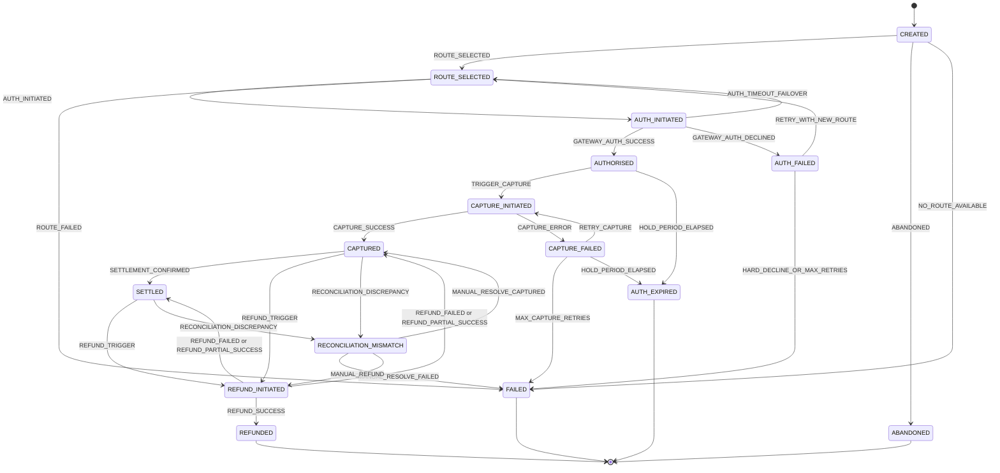

# Transaction State Machine Specification

## 1. Overview
The Transaction State Machine is the core source of truth for all payment lifecycles within the PayFlow payment orchestration layer. It enforces deterministic state transitions, prevents fraudulent or invalid transaction updates, and records an immutable audit log for every change. Direct mutation of `transactions.state` is prohibited: every change goes through the state machine, which validates `from_state → to_state`, writes the `transaction_audit` row and updates `state_updated_at` in one database transaction.

It is driven by six sources of events: the Orchestrator (routing, auth, and automatic capture), the Intelligent Router / Circuit Breaker, merchant API calls (refunds), gateway webhooks, the Reconciliation Engine, and operators using the admin dashboard.

## 2. State Definitions

The orchestration system implements 15 explicit states to manage the two-phase payment lifecycle (Authorisation and Capture), settlement, refunds, and edge cases. The first 11 plus `ABANDONED`, `SETTLED` and `RECONCILIATION_MISMATCH` come from the architecture document; `AUTH_EXPIRED` is retained as an additional state.

| State | Category | Description |
| :--- | :--- | :--- |
| `CREATED` | Initial | Payment record initialized in the system; no gateway interaction has occurred yet. |
| `ROUTE_SELECTED` | Processing | Routing algorithm has selected the optimal payment gateway based on scoring. Entering this state increments `attempt_count`. |
| `AUTH_INITIATED` | Processing | Request sent to the selected gateway to authorize funds. |
| `AUTHORISED` | Intermediate | Gateway confirmed funds authorization hold. The gateway is pinned from here on. |
| `AUTH_FAILED` | Intermediate | Gateway declined the authorization request. |
| `CAPTURE_INITIATED` | Processing | Capture request submitted for authorized funds. |
| `CAPTURED` | Intermediate | Funds successfully captured from the gateway, awaiting settlement. Refundable. |
| `CAPTURE_FAILED` | Intermediate | Capture attempt failed; retry is permitted until the retry limit or hold expiry. |
| `SETTLED` | Final (refundable) | Settlement of captured funds confirmed by reconciliation. A refund may still be initiated. |
| `REFUND_INITIATED` | Processing | Refund request submitted to the gateway for captured or settled funds. |
| `REFUNDED` | Terminal | Full payment amount successfully refunded to the customer. |
| `FAILED` | Terminal | Hard failure, no route available, or maximum retries exceeded; no further recovery possible. |
| `AUTH_EXPIRED` | Terminal | Authorization hold period elapsed without capture. |
| `ABANDONED` | Terminal | Customer or system timeout before any routing took place. |
| `RECONCILIATION_MISMATCH` | Exception (manual) | Reconciliation found internal state and gateway status disagree. Alerts operators; **never auto-refunds**. Leaves this state only by operator action. |

---

## 3. Mermaid State Transition Diagram

`REFUND_INITIATED` returns to whichever of `CAPTURED` or `SETTLED` it came from (see rule 3 in Section 4.1).

---

## 4. Valid Transition Matrix

The table below defines all valid transitions. Any event not explicitly allowed for a given state triggers an `InvalidStateTransitionException`.

| Current State | Event / Trigger | Target State | Permitted Initiator |
| :--- | :--- | :--- | :--- |
| `CREATED` | `ROUTE_SELECTED` | `ROUTE_SELECTED` | Gateway Router |
| `CREATED` | `ABANDONED` | `ABANDONED` | User / System Timeout |
| `CREATED` | `NO_ROUTE_AVAILABLE` | `FAILED` | Gateway Router (all gateways `OPEN`, inactive, or unable to serve the payment method) |
| `ROUTE_SELECTED` | `AUTH_INITIATED` | `AUTH_INITIATED` | Orchestrator |
| `ROUTE_SELECTED` | `ROUTE_FAILED` | `FAILED` | Router Exception |
| `AUTH_INITIATED` | `GATEWAY_AUTH_SUCCESS` | `AUTHORISED` | Gateway Webhook / API, Timeout Monitor (status check), Reconciliation Job |
| `AUTH_INITIATED` | `GATEWAY_AUTH_DECLINED` | `AUTH_FAILED` | Gateway Webhook / API, Reconciliation Job |
| `AUTH_INITIATED` | `AUTH_TIMEOUT_FAILOVER` | `ROUTE_SELECTED` | Timeout Monitor |
| `AUTH_FAILED` | `RETRY_WITH_NEW_ROUTE` | `ROUTE_SELECTED` | Orchestrator |
| `AUTH_FAILED` | `HARD_DECLINE_OR_MAX_RETRIES` | `FAILED` | Orchestrator (also used when no alternate healthy gateway exists) |
| `AUTHORISED` | `TRIGGER_CAPTURE` | `CAPTURE_INITIATED` | Auto-Capture (system) |
| `AUTHORISED` | `HOLD_PERIOD_ELAPSED` | `AUTH_EXPIRED` | Reconciliation Job |
| `CAPTURE_INITIATED` | `CAPTURE_SUCCESS` | `CAPTURED` | Gateway Webhook / API, Reconciliation Job |
| `CAPTURE_INITIATED` | `CAPTURE_ERROR` | `CAPTURE_FAILED` | Gateway Webhook / API, Reconciliation Job |
| `CAPTURE_FAILED` | `RETRY_CAPTURE` | `CAPTURE_INITIATED` | Orchestrator Queue |
| `CAPTURE_FAILED` | `MAX_CAPTURE_RETRIES` | `FAILED` | Orchestrator Queue |
| `CAPTURE_FAILED` | `HOLD_PERIOD_ELAPSED` | `AUTH_EXPIRED` | Reconciliation Job |
| `CAPTURED` | `SETTLEMENT_CONFIRMED` | `SETTLED` | Reconciliation Job |
| `CAPTURED` | `REFUND_TRIGGER` | `REFUND_INITIATED` | Merchant API |
| `CAPTURED` | `RECONCILIATION_DISCREPANCY` | `RECONCILIATION_MISMATCH` | Reconciliation Job |
| `SETTLED` | `REFUND_TRIGGER` | `REFUND_INITIATED` | Merchant API |
| `SETTLED` | `RECONCILIATION_DISCREPANCY` | `RECONCILIATION_MISMATCH` | Reconciliation Job |
| `REFUND_INITIATED` | `REFUND_SUCCESS` | `REFUNDED` | Gateway Webhook / API (cumulative succeeded refunds equal the full amount) |
| `REFUND_INITIATED` | `REFUND_PARTIAL_SUCCESS` | previous state (`CAPTURED` or `SETTLED`) | Gateway Webhook / API (more of the amount remains refundable) |
| `REFUND_INITIATED` | `REFUND_FAILED` | previous state (`CAPTURED` or `SETTLED`) | Gateway Webhook / API |
| `RECONCILIATION_MISMATCH` | `MANUAL_RESOLVE_CAPTURED` | `CAPTURED` | Operator |
| `RECONCILIATION_MISMATCH` | `MANUAL_RESOLVE_FAILED` | `FAILED` | Operator |
| `RECONCILIATION_MISMATCH` | `MANUAL_REFUND` | `REFUND_INITIATED` | Operator |

### 4.1 Transition Rules

1. **Guard first:** the state machine reads the current state under `SELECT ... FOR UPDATE`, checks the matrix, then writes. A `from_state` that does not match the stored state is rejected, not coerced.
2. **Side effects on entry:** entering `ROUTE_SELECTED` increments `attempt_count` and stores the chosen `gateway_id`; entering `AUTHORISED` sets `auth_expires_at` and pins the gateway; every transition sets `state_updated_at`.
3. **Refund return state:** the "previous state" for `REFUND_PARTIAL_SUCCESS` / `REFUND_FAILED` is the `from_state` of the most recent `REFUND_TRIGGER` or `MANUAL_REFUND` audit row. Partial refunds are recorded in `refunds`; the sum of `INITIATED` + `SUCCEEDED` refunds can never exceed the captured amount.
4. **Operator transitions** (`MANUAL_*`) require an operator identity in `created_by` and a reason in `metadata`.
5. **Merchant-triggered events** (`REFUND_TRIGGER`) arrive through the idempotent API path, so a retried request cannot trigger a second refund. Capture is never merchant-triggered: `TRIGGER_CAPTURE` is raised by the system once, immediately after `AUTHORISED`.

---

## 5. Multi-Gateway Behaviour

The state machine models one transaction's lifecycle. Gateways (Paystack, Pesapal, Flutterwave, DPO) are data on the transaction, not separate branches of the diagram.

1. **Gateway selection:** every pass through `ROUTE_SELECTED` may pick a different gateway using the weighted score (Success 35%, Latency 20%, Cost 20%, Health 15%, Payment Method Fit 10%, configurable in `routing_config`). Candidates are limited to gateways the merchant has connected (an `ACTIVE` row in `merchant_gateway_accounts`); gateways whose circuit is `OPEN`, that are inactive, or that do not support the payment method/currency in `gateway_payment_methods` are excluded. The chosen gateway is stored in `transactions.gateway_id` and recorded on each `transaction_audit` row, so the full per-attempt history is preserved.
2. **Failover window:** failover to another gateway (`AUTH_TIMEOUT_FAILOVER`, `RETRY_WITH_NEW_ROUTE`) is only allowed before `AUTHORISED`.
3. **Gateway pinning:** once a transaction reaches `AUTHORISED`, its gateway is fixed. `CAPTURE_INITIATED` and `REFUND_INITIATED` must go to the same gateway that authorised the funds, and neither `transactions.gateway_id` nor `transactions.gateway_account_id` may change afterwards (database trigger enforces this).
4. **Timeout failover safety:** before `AUTH_TIMEOUT_FAILOVER` retries on a different gateway, the orchestrator must query the original gateway's status (and cancel the pending authorisation where the gateway supports it). If the original gateway confirms the authorisation, the transaction transitions to `AUTHORISED` via `GATEWAY_AUTH_SUCCESS` instead of failing over. This prevents the customer being held twice. A late webhook from a previously attempted gateway must be checked against the transaction's current gateway and state before it is applied (see Section 7).
5. **Failover latency budget:** the P95 failover target is under 2.0 s. The per-attempt timeout (`routing_config.auth_timeout_ms`) plus the status-check budget (`failover_status_check_timeout_ms`) must fit inside it. When a gateway's circuit is already `OPEN`, routing skips it up front, so no timeout is incurred.
6. **Retry limit:** `transactions.attempt_count` is incremented **each time** a transaction enters `ROUTE_SELECTED` (including the first time, from `CREATED`). When it reaches `routing_config.max_auth_attempts`, `HARD_DECLINE_OR_MAX_RETRIES` moves the transaction to `FAILED`. If no alternate healthy gateway exists, the same event applies with `metadata.reason = NO_ALTERNATE_GATEWAY`.
7. **Circuit breaker feedback:** every gateway outcome updates `gateway_health_metrics`. Five consecutive gateway/network failures open the circuit; after the 30-second cooldown a single probe request is allowed (`HALF_OPEN`). A declined card is a business outcome and does **not** count toward the breaker; timeouts, network errors and 5xx responses do.
8. **Card payments and failover:** the same vault token is reused when failing over, so a card can move between gateways without the customer re-entering it, subject to the vault retention rules in Section 10. Non-card methods do not depend on the vault.
9. **Single connected gateway:** if the merchant has only one `ACTIVE` gateway account there is nowhere to fail over to. After a timeout the transaction stays in `AUTH_INITIATED` (no `AUTH_TIMEOUT_FAILOVER` is raised) and reconciliation resolves it; after a decline, `HARD_DECLINE_OR_MAX_RETRIES` applies with `metadata.reason = NO_ALTERNATE_GATEWAY`.

---

## 6. Audit Trail & Immutability Rules

1. **No In-Place Modifications of History:** State changes are appended to the `transaction_audit` table (architecture name: `transaction_state_log`). Rows are never updated; a trigger rejects `UPDATE`/`DELETE`. Foreign key to `transactions` is `ON DELETE RESTRICT`.
2. **Database Locks:** Row-level locking (`SELECT FOR UPDATE`) on the transaction must be acquired before executing a state evaluation. Idempotency checks use `pg_advisory_xact_lock` on the hash of `(merchant_id + idempotency_key)` before the transaction row is created.
3. **One transition, one audit row, one transaction:** the state update, the audit insert and (for webhooks) the dedup insert into `webhook_events` commit together or not at all.
4. **Audit Schema Enforcement:**
   - `id`: UUID (Primary Key)
   - `transaction_id`: UUID (Foreign Key to `transactions`)
   - `from_state`: ENUM `transaction_state` (NULL only on the initial `CREATED` row)
   - `to_state`: ENUM `transaction_state`
   - `event`: VARCHAR(100)
   - `attempt_number`: INTEGER (`attempt_count` at the time)
   - `gateway_id`: UUID (Foreign Key to `gateways`)
   - `gateway_reference`: VARCHAR(255)
   - `gateway_response`: JSONB (PII Redacted before insert)
   - `metadata`: JSONB
   - `created_at`: TIMESTAMPTZ
   - `created_by`: VARCHAR(100), default `system`; otherwise `webhook:<gateway>`, `reconciliation`, or `operator:<id>`

---

## 7. Webhook Handling & Out-of-Order Delivery

Each merchant gateway account has its own webhook URL, so the account (and its signing secret) is identified before anything is parsed. Webhooks are verified with HMAC and a constant-time comparison, then deduplicated on `(gateway_account_id, event_id)` before reaching the state machine. A duplicate returns `200 OK` immediately. Accepted events are recorded in `webhook_queue` first; SQS only carries them.

Each verified event is mapped to a state machine event and applied by these rules:

| Situation | Handling |
| :--- | :--- |
| **Valid transition** from the current state | Apply, write audit row, record in `webhook_events`. |
| **Stale event** (its target is behind the current state, e.g. `AUTH_INITIATED`/`GATEWAY_AUTH_SUCCESS` arrives after the transaction is `CAPTURED`) | Ignore gracefully: return `200 OK`, record in `webhook_events`, note `ignored_stale` in the audit `metadata` of the existing state if useful. No state change. |
| **Early event** (target is ahead of the current state, e.g. `CAPTURE_SUCCESS` arrives while `AUTH_INITIATED` because the auth webhook is delayed) | Do not apply. Enqueue in `webhook_queue`; retry with backoff (1 s, 2 s, 4 s) so the missing predecessor can arrive or be reconciled. |
| **Event from a previously attempted gateway** (not the transaction's current `gateway_id`) | Never applied blindly. If it reports an authorisation that would double-hold the customer, flag for reconciliation and cancel/void at that gateway where supported. |
| **Genuinely invalid** for the current state | `InvalidStateTransitionException`; log, route through the queue retry policy. |
| **Processing failure** after 3 retries | Fourth failure moves the event to `DLQ` for manual replay. |

---

## 8. Reconciliation & Anomaly Handling

An automated batch runs **every 15 minutes** (one `reconciliation_runs` row per execution).

1. **Detection:** select transactions in `AUTH_INITIATED`, `CAPTURE_INITIATED` or `REFUND_INITIATED` whose `state_updated_at` is older than the gateway timeout limit (5 minutes), using the `idx_transactions_pending_recon` index.
2. **Verification:** fetch the real status from the transaction's gateway by direct API polling, using the merchant's gateway account credentials from Secrets Manager (HTTP calls made outside any open DB transaction).
3. **Resolution:** apply the matching event from the matrix with initiator *Reconciliation Job* (`GATEWAY_AUTH_SUCCESS`, `GATEWAY_AUTH_DECLINED`, `CAPTURE_SUCCESS`, `CAPTURE_ERROR`, `REFUND_SUCCESS`, `REFUND_FAILED`). Log each as `STUCK_PENDING_RESOLVED` in `reconciliation_logs`.
4. **Hold expiry:** `AUTHORISED` or `CAPTURE_FAILED` transactions with `auth_expires_at` in the past move to `AUTH_EXPIRED` via `HOLD_PERIOD_ELAPSED`.
5. **Settlement:** when the gateway settlement data confirms funds for a `CAPTURED` transaction, apply `SETTLEMENT_CONFIRMED`.
6. **Anomaly escalation:** if the transaction is internally `CAPTURED` (or `SETTLED`) but the gateway reports `FAILED` or `REVERSED`, apply `RECONCILIATION_DISCREPANCY`, write a `reconciliation_logs` row with `discrepancy_flag = TRUE` (`CAPTURED_GATEWAY_FAILED` / `CAPTURED_GATEWAY_REVERSED`), and send an alert. **No auto-refund is triggered.** An operator resolves it with `MANUAL_RESOLVE_CAPTURED`, `MANUAL_RESOLVE_FAILED` or `MANUAL_REFUND`.

---

## 9. Concurrency & Execution Rules

| Edge Case | Resolution |
| :--- | :--- |
| **Simultaneous requests with the same key** | Advisory lock on hash of `(merchant_id + idempotency_key)` before the status check. `PROCESSING` returns `409 Conflict`; `COMPLETED` replays the cached response. |
| **Simultaneous events for one transaction** | The second event waits on `SELECT ... FOR UPDATE`, then is evaluated against the new state (and treated as stale or invalid per Section 7). |
| **Gateway timeout during auth/capture** | Circuit breaker records the failure; failover follows Section 5 within the 2 s P95 budget. |
| **Connection pool exhaustion** | A DB connection is acquired only to read/write state and released **before** any HTTP gateway call (including status checks and reconciliation polling). Locks are never held across a network call. |
| **Targets** | Payment initiation under 500 ms (P95); idempotency check under 10 ms. |

---

## 10. Card Data Lifecycle & Merchant Notifications

1. **Where card data lives:** card numbers and security codes exist only in the Card Vault. A transaction refers to them by `card_token_id`; no state machine table ever holds them.
2. **Purge triggers:** on entering `AUTHORISED`, `FAILED` or `ABANDONED`, the state machine asks the vault to erase the card number and delete the security code. Both also expire on a timer (card 60 minutes, security code 15 minutes, configurable). Capture, refund and reconciliation use `gateway_reference`, never the card.
3. **Retry dependency:** `RETRY_WITH_NEW_ROUTE` and `AUTH_TIMEOUT_FAILOVER` for card payments need a live vault entry. If it has expired or been purged, the transaction moves to `FAILED` through `HARD_DECLINE_OR_MAX_RETRIES` with `metadata.reason = CARD_DATA_UNAVAILABLE`, and the merchant must create a new payment.
4. **Purge failures:** a failed purge raises an alert and is retried. The timer is the backstop.
5. **Merchant notifications:** every transition inserts any needed `merchant_webhook_deliveries` rows in the same database transaction (transactional outbox). The mapping from transitions to event types is in the architecture document (Section 3.8). `RECONCILIATION_MISMATCH` sends no merchant event.
6. **Operator actions:** `MANUAL_*` transitions and DLQ replays are also written to `admin_audit_log`.